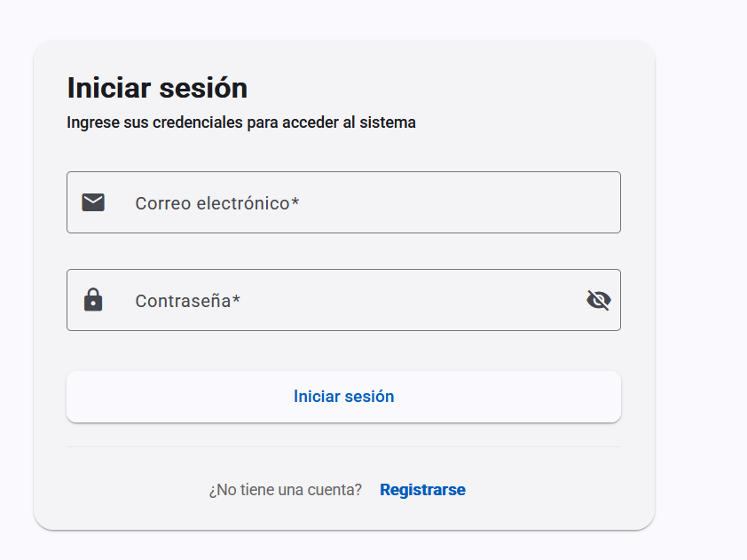
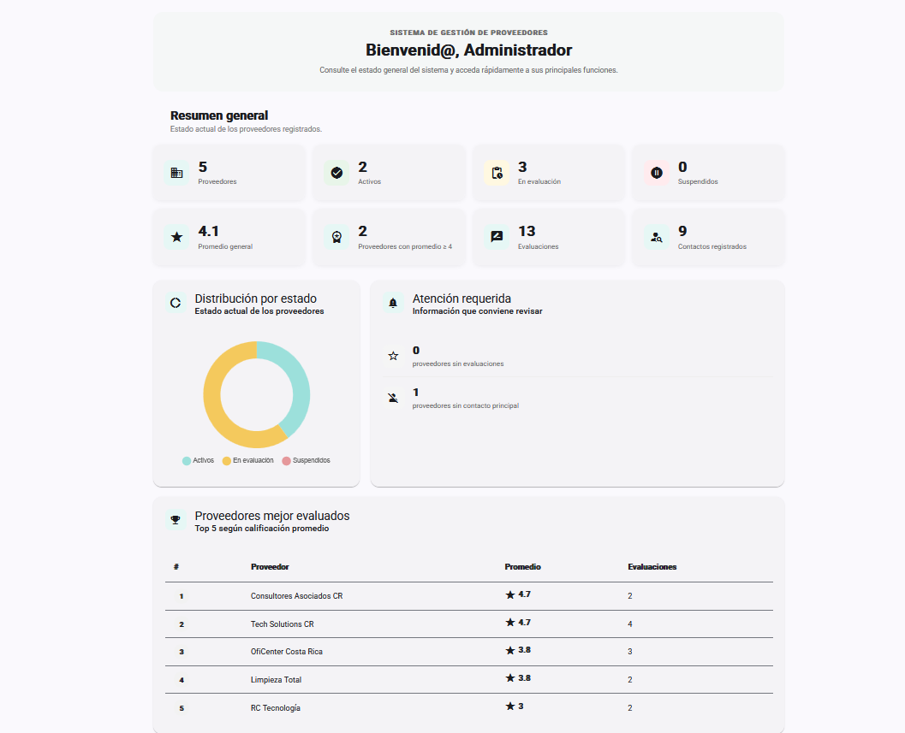
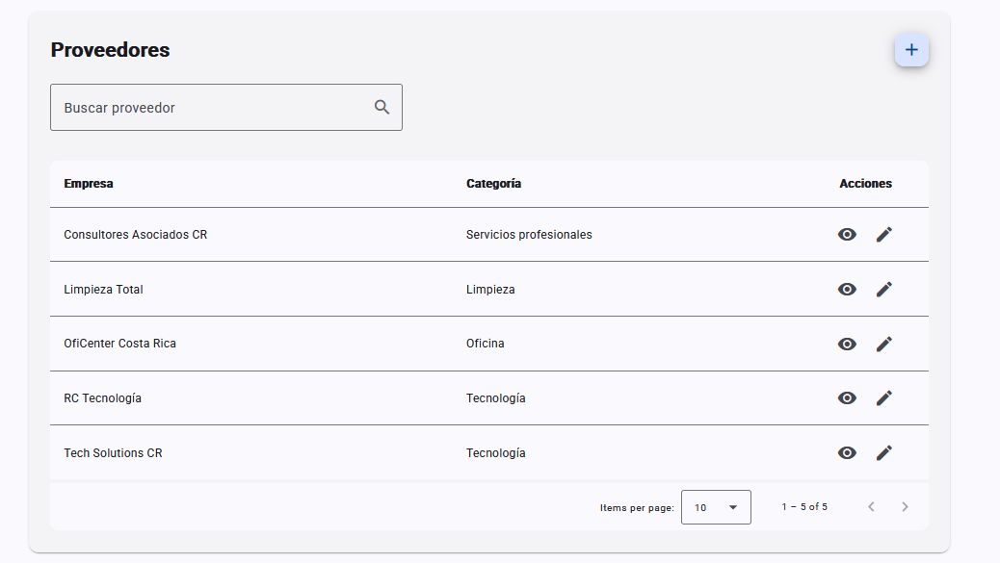

# Sistema de Gestión de Proveedores

Aplicación web para centralizar la administración, el seguimiento y la evaluación de proveedores, desarrollada como proyecto de Ingeniería del Software.

## Descripción

El Sistema de Gestión de Proveedores permite administrar la información de los proveedores desde una plataforma centralizada. Facilita el registro de empresas, la organización por categorías, la gestión de contactos y el seguimiento de evaluaciones mediante calificaciones y comentarios.

Además, incorpora autenticación y control de acceso basado en roles, así como un dashboard con indicadores generales que permiten consultar información relevante para la gestión de proveedores.

## Manual de usuario

El manual de usuario proporciona instrucciones para navegar por el sistema y utilizar sus funcionalidades, incluyendo la gestión de proveedores, contactos, categorías, evaluaciones y usuarios. También describe los permisos disponibles según el rol asignado.

**[Consultar el Manual de Usuario (PDF)](docs/Manual_Usuario_Proveedores.pdf)**

## Capturas de pantalla

### Inicio de sesión



### Dashboard



### Gestión de proveedores



## Funcionalidades principales

- **Dashboard:** consulta de indicadores, estadísticas y resumen de la información registrada.
- **Gestión de proveedores:** registro, consulta, edición y seguimiento del estado de los proveedores.
- **Gestión de categorías:** organización de proveedores por categorías.
- **Gestión de contactos:** administración de los contactos asociados a cada proveedor.
- **Evaluación de proveedores:** registro y consulta de calificaciones y comentarios.
- **Gestión de usuarios:** administración de cuentas y permisos según el rol asignado.
- **Mi perfil:** consulta y actualización de la información personal.
- **Autenticación:** inicio de sesión, registro de usuarios y protección de rutas mediante autenticación.
- **Control de acceso:** restricción de funcionalidades según los permisos de cada rol.

## Roles de usuario

| Rol | Descripción |
|---|---|
| **Administrador** | Acceso a las funciones administrativas y gestión de usuarios. |
| **Compras** | Gestión de proveedores, contactos y evaluaciones según sus permisos. |
| **Consulta** | Acceso de solo lectura a las secciones autorizadas. |

## Tecnologías utilizadas

### Frontend

- Angular
- TypeScript
- Angular Material
- HTML5
- CSS3

### Backend

- Node.js
- Express
- JavaScript y TypeScript
- Prisma ORM

### Base de datos

- MySQL / MariaDB

### Herramientas de desarrollo

- Git y GitHub
- npm

## Estructura del proyecto

```text
Sistema_Gestion_Proveedores/
├── client/
│   └── sistema_gestion_proveedores/
│       └── Aplicación Angular
├── server/
│   ├── controllers/
│   ├── middlewares/
│   ├── routes/
│   ├── prisma/
│   │   ├── migrations/
│   │   └── seeds/
│   ├── app.js
│   └── prisma.config.ts
├── docs/
│   ├── capturas/
│   │   ├── inicio-sesion.png
│   │   ├── dashboard.png
│   │   └── proveedores.png
│   ├── Manual_Usuario_Proveedores.pdf
│   └── instalacion.md
├── .gitignore
└── README.md
```

## Instalación y ejecución

Consulta la [Guía de instalación](docs/instalacion.md) para conocer los requisitos previos, configurar la base de datos, preparar las variables de entorno y ejecutar el frontend y el backend localmente.

La guía también incluye los pasos para aplicar las migraciones y cargar los datos de demostración.

## Seguridad

- Las credenciales y los secretos deben configurarse mediante variables de entorno.
- El archivo `.env` no debe publicarse en el repositorio.
- El archivo `.env.example` contiene valores de referencia para facilitar la configuración inicial.
- Las contraseñas de los usuarios de demostración se almacenan mediante hash en la base de datos.

## Estado del proyecto

Proyecto desarrollado con fines académicos y de portafolio profesional.
